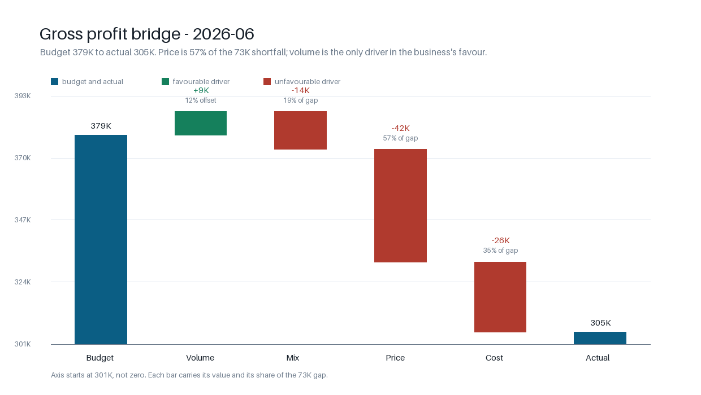
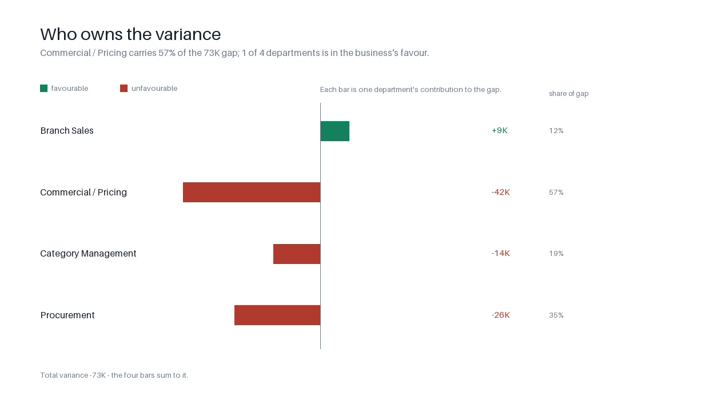
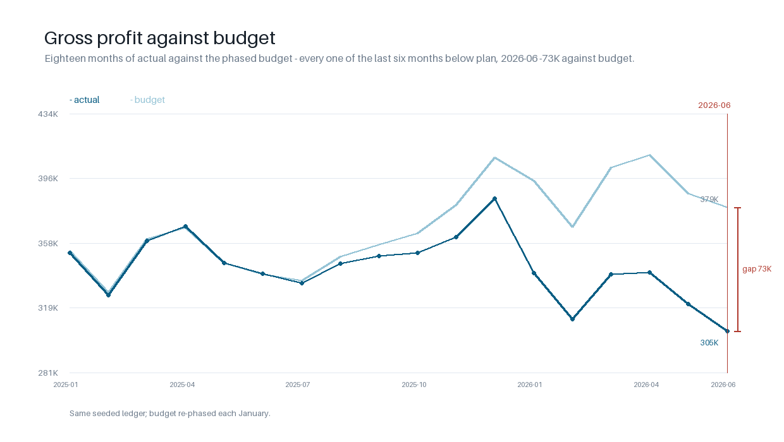

# Monthly management pack — budget vs actual, decomposed by driver

> **A worked case study, and the data is synthetic — disclosed on this line.**
> A three-branch wholesaler missed its gross-profit budget by **19.38%** while
> revenue came in **0.74%** off plan. This repo splits that shortfall into
> volume, price, mix and cost, attributes each to the department that owns it,
> and proves the four components reconcile to the cent.

Most variance reports subtract two numbers and call the difference "unfavourable".
That answer cannot be acted on, because it does not say whether the business sold
less, charged less, bought worse, or simply sold a different blend of products.
This pack answers that.

## The question

> Sales are within 1% of budget and gross profit is nearly 19% behind it.
> Where did the profit go, and who owns it?

## The answer

| | |
|---|---|
| **Headline** | Revenue **KES 1,463,426.72** budget against **KES 1,452,532.75** actual (-0.74%). Gross profit **KES 378,744.50** budget against **KES 305,338.59** actual — a shortfall of **KES 73,405.91** (-19.38%). |
| **The four drivers** | Price **-41,943.76**, cost **-26,053.41**, mix **-14,164.16**, volume **+8,755.42**. Price is the largest single driver: the Nakuru branch discounted its way through the year. |
| **Who owns it** | Commercial / Pricing **-41,943.76**, Procurement **-26,053.41**, Category Management **-14,164.16**, Branch Sales **+8,755.42**. |
| **The twist** | Volume is *favourable*. The business sold slightly more units than it budgeted and still lost a fifth of its gross profit — so "we need more sales" is the wrong instruction this month. |
| **Data** | **Synthetic**: 18 months × 3 branches × 40 SKUs, generated from a seeded, documented mechanism — ledger fingerprint `f8b8fa811c7ef11b`. |
| **Checks** | **17/17** published in [`outputs/validation_report.md`](outputs/validation_report.md) — seventeen checks over sixteen distinct identities; the bridge reconciles to the cent. |

## What it looks like



*Budget to actual in four labelled steps: each bar carries its value and its share
of the **KES 73,405.91** gap, the two colours mean favourable and unfavourable,
and the axis starts at 301K rather than zero so a 73K movement is visible instead
of flattened against a million-shilling level.*



*Each department's contribution to the gap, with its share. Ownership is
arithmetic: the department that can move the largest component of a line owns the
line, so an owner can argue with the numbers but not with the method.*



*Eighteen months of actual against the phased budget, with the current month's gap
bracketed and labelled. Every one of the last six months is below plan — which is
why the branch rule reads a trend, not a single month.*

## The deliverables

| Output | File | What it is for |
|---|---|---|
| **Report** | [`docs/report-2026-06.md`](docs/report-2026-06.md) | the narrative with tables and charts inline |
| **PDF** | [`docs/monthly-pack-2026-06.pdf`](docs/monthly-pack-2026-06.pdf) | what goes into the management meeting: headline, bridge, owners, lines, actions |
| **Slides** | [`docs/monthly-pack-2026-06.pptx`](docs/monthly-pack-2026-06.pptx) | eight slides telling the same story in reading order |
| **Brief** | [`docs/how-a-management-pack-is-produced.md`](docs/how-a-management-pack-is-produced.md) | how this runs month to month in a real trading business |

All four are generated from the same answer key, so a figure cannot disagree
between them, and rebuilding is reproducible: `make docs`. The PDF and the deck
need two optional packages, installed once with
`python3 -m pip install --target .venv-site -r requirements-docs.txt`.

## Why a flexed budget, not a subtraction

A budget is built on planned volume. Comparing it with actual spend at actual
volume mixes two effects and calls the result a variance. The fix is the **flexed
budget**: actual volume valued at budget price and budget cost. It answers
"what would we have made if we had hit the prices and costs we planned, on the
units we actually sold?" — and it is the hinge the whole decomposition turns on.

- budget → flex is **volume and mix** (how much was sold, and what blend)
- flex → actual is **price and cost** (what was charged, and what was paid)

## The bridge

| Driver | KES | Share of budget gross profit |
|---|---:|---:|
| Budget gross profit | 378,744.50 | |
| Volume — total units at the budget margin per unit | 8,755.42 | 2.31% |
| Mix — selling a different blend at budget margins | -14,164.16 | -3.74% |
| Price — actual units at the change in selling price | -41,943.76 | -11.07% |
| Cost — actual units at the change in unit cost | -26,053.41 | -6.88% |
| **Actual gross profit** | **305,338.59** | |

`8,755.42 + (-14,164.16) + (-41,943.76) + (-26,053.41) = -73,405.91`, which is
actual gross profit less budget gross profit, exactly. The flexed budget itself is
**KES 373,335.76** — actual volume at budget rates.

Mix is computed as the residual of the volume-and-mix movement after the total-volume
effect is taken out, so the identity holds by construction rather than by rounding
luck. The algebra is written out in [`docs/01_method.md`](docs/01_method.md).

## The 4 exceptions, each with an owner

Materiality is KES 10,000 of gross-profit impact for the month.

| Line | Finding | Impact (KES) | Owner | Action |
|---|---|---:|---|---|
| Nakuru | Prices realised 9.87% below the budgeted price for the volume sold | -40,901.06 | Commercial / Pricing | Reissue the price file and cap discount authority at 7% |
| Home Care | Unit costs 6.56% above budget on the volume bought | -25,934.14 | Procurement | Renegotiate supply terms or reprice the range |
| Mombasa Road | Units below budget in 3 of the last 3 months, 10.86% down on a rolling basis | -41,382.41 | Branch Sales | Rebuild the trading plan against the trend gap |
| Product mix | Staples moved from 25.00% of budgeted units to 31.56% | -14,164.16 | Category Management | Review ranging and promo depth against the budgeted blend |

The full pack — headline, bridge, exceptions, branch and category splits, and the
three actions for Monday — is generated at [`outputs/MONTHLY_PACK.md`](outputs/MONTHLY_PACK.md).

## Where it sits

| Branch | Budget GP | Actual GP | Variance | % |
|---|---:|---:|---:|---:|
| Nakuru | 98,155.07 | 56,021.11 | -42,133.96 | -42.93% |
| Mombasa Road | 122,698.84 | 95,653.57 | -27,045.27 | -22.04% |
| Nairobi CBD | 157,890.59 | 153,663.91 | -4,226.68 | -2.68% |

One branch discounting and one branch under-trading account for almost the whole
shortfall; the largest branch is within 3% of plan. That is a management answer,
not a chart.

The branch rule reads **units over a trailing three-month window**, not one
month's shortfall: Mombasa Road has been below budget in all three of the last
three months, which is a branch drifting rather than a bad month. Nairobi and
Nakuru are *above* plan on units — their misses are price and cost, and the rule
would be wrong to call them a trading problem.

## Where it sits, by line

All 120 product lines are decomposed the same way, and every one carries an
owner — the department that can move the largest part of that line. The five
worst:

| Branch | Product | Variance | Price | Unit cost | Volume revenue | Volume cost | Owner |
|---|---|---:|---:|---:|---:|---:|---|
| Nakuru | Fabric Softener 1L | -3,950.82 | -2,742.60 | -1,068.00 | -462.22 | 322.00 | Commercial / Pricing |
| Nakuru | Scouring Powder 500g | -3,527.86 | -2,428.80 | -970.75 | -422.94 | 294.63 | Commercial / Pricing |
| Mombasa Road | Fabric Softener 1L | -3,427.92 | 104.40 | -1,288.80 | -7,395.52 | 5,152.00 | Branch Sales |
| Mombasa Road | Scouring Powder 500g | -3,051.30 | -92.96 | -1,162.00 | -5,921.16 | 4,124.82 | Branch Sales |
| Nakuru | Air Freshener 300ml | -2,824.04 | -1,963.84 | -860.20 | 0.00 | 0.00 | Commercial / Pricing |

Every line is published in [`outputs/tables/line_variance.csv`](outputs/tables/line_variance.csv)
and in the answer key, so a manager can filter to their own branch or category.

The two columns that matter for diagnosis are **price** and **unit cost**: both
are valued at the volume actually sold, which is what separates a line that
charged too little from one that bought too dear, independent of how much moved.
The volume charge is split into its revenue and cost halves at budget rates, so
the four columns add to the line's variance exactly. 25 of the 120 lines finished
above budget — the shortfall is concentrated, not spread.

Owner split by line: Commercial / Pricing 49, Branch Sales 56, Procurement 15.
No line is owned by Category Management, which is correct: mix is a portfolio
effect and cannot be attributed to a single product line.

## What this project demonstrates

1. **Management accounting, not just reporting** — a flexed budget, a driver-level
   bridge, and the discipline to separate "we sold less" from "we discounted more".
2. **Numbers an accountant would sign** — every component is exact decimal
   arithmetic, and the bridge reconciles to the cent rather than approximately.
3. **A pack that runs itself** — one command regenerates the ledger, the pack, the
   tables, the charts and the validation report, byte-identically.
4. **Every claim tested** — the generator's shape and determinism, the bridge
   identities, the attribution, the exceptions, and the README's own figures are
   all guarded by tests.

## Run it

```bash
git clone https://github.com/BIAnalyst-Patrick/monthly-management-pack
cd monthly-management-pack

make test    # full suite, including the README drift guard
make run     # regenerates the ledger, pack, tables, answer key and charts
```

One month, without touching the published pack:

```bash
python -m pack.report --month 2025-12   # writes scratch/2025-12/
```

A single month is a scratch run. It writes under `scratch/<month>/`, which git
ignores, so following this README cannot overwrite the committed artefacts in
`outputs/`. That is deliberate: `outputs/` is the release, and `make run` is the
only thing that regenerates it. Pass `--out DIR` to choose another scratch
directory.

The suite also renders a second month, December 2025, and compares it byte for
byte against the golden files in `tests/fixtures/2025-12/`. That month carries
one exception where June carries four, so the renderers are exercised on a shape
they were not written against. After a deliberate rendering change:

```bash
make fixture   # rewrites tests/fixtures/2025-12/ for review in the diff
```

No installation. The analysis is standard library only; the charts need Pillow,
and the committed PNGs mean a reader never has to install it.

## What is out of scope

- **Gross profit, not net profit.** Overhead is not allocated, so a favourable
  branch here is favourable before central costs.
- **Single currency (KES), no tax, no foreign exchange, no write-offs.**
- **A monthly control pack, not a forecast.** The budget is fixed; there is no
  re-forecast, no driver-based rolling plan and no scenario modelling.
- **The data is simulated.** It is generated from four documented mechanisms plus
  seeded noise so that the diagnosis can be *graded* rather than merely asserted.
  No client figures appear anywhere in this repository.

| Planted mechanism | Starts | What it makes visible |
|---|---|---|
| Branch-wide discounting in Nakuru, 0.8% deeper each month | 2025-05 | adverse price variance |
| Staples (15% margin) growing 2.2%/month while Home Care stays flat | 2025-03 | adverse mix |
| Home Care supplier cost step of +6.5% | 2026-01 | adverse cost variance |
| Mombasa Road volume decaying 1.8%/month | 2025-08 | adverse volume variance |

## Repository layout

```
pack/
  model.py       catalogue, ledger lines, parsing (Decimal money)
  generator.py   the seeded budget and the actuals that drift from it
  bridge.py      flexed budget, the four-component bridge, owner attribution
  lines.py       the per-line decomposition and who owns each line
  trends.py      the branch trend rule over a trailing window
  exceptions.py  what is material enough to carry an owner, and the evidence
  analysis.py    one month assembled from the rules above
  key.py         the answer key: one JSON schema for every published number
  render.py      the markdown, and the exception prose
  tables.py      the six CSV tables
  cli.py         argument parsing and the scratch output root
  report.py      thin entry point for `python -m pack.report`
  validation.py  the seventeen checks
  charts.py      three committed PNGs
  money.py       one formatter per output shape (cents, plain, grouped, kes, pct)
  pipeline.py    one run from ledger to artefacts
docs/                     the report, the method brief, the PDF and the deck
data/ledger.json          every budget and actual line, 18 months
scratch/                  ignored: output of single-month CLI runs
requirements-docs.txt     optional extras for `make docs` (PDF and slides)
outputs/MONTHLY_PACK.md   the pack itself
outputs/answer_key.json   every number quoted above, including all 120 lines
outputs/tables/           bridge, exceptions, branch, category, line and trend CSVs
outputs/validation_report.md
tests/                    the suite, including the README drift guard
tests/fixtures/2025-12/   golden pack for a month the renderers were not written for
```

## Data

Seed `20260101`, fingerprint `f8b8fa811c7ef11b`. Regenerate with `make run` and
the fingerprint should be identical; if it is not, the ledger you are reading is
not the ledger this README describes. The 17 checks in
[`outputs/validation_report.md`](outputs/validation_report.md) include a
fingerprint guard, so a hand-edited line is caught rather than accommodated.
